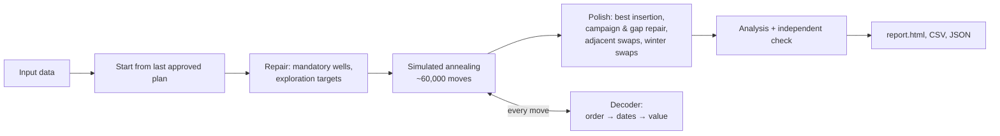

# Rig Schedule Optimizer

A proof-of-concept tool that assigns a portfolio of planned offshore wells to a fixed fleet of drilling rigs and
orders them in time, producing a **rig schedule that maximizes pre-tax portfolio value** while respecting the
technical, operational and portfolio rules of a real drilling plan.

It reads a portfolio (wells, rigs, installations, production profiles, prices, weather), searches for a better
schedule than the current plan, checks every result independently, and writes a self-contained HTML report with an
interactive Gantt chart, economics, rig utilization, exploration targets, weather exposure and an explanation for
every well that was not scheduled.

> **All data in this repository is synthetic.** Field and asset names are real Norwegian Continental Shelf names, and
> the default dataset uses names of real Noble, Odfjell (Deepsea) and Transocean rigs. However, wells, coordinates,
> costs, profiles, rig capabilities, speeds, contracts and day rates are all generated and do not describe the real
> fields or rigs. Results illustrate the method; they are not a recommendation for any real portfolio.

---

## Contents

- [What it does](#what-it-does)
- [Example results](#example-results)
- [Quick start](#quick-start)
- [How the optimization works](#how-the-optimization-works)
- [Rules: hard constraints and soft preferences](#rules-hard-constraints-and-soft-preferences)
- [Value model](#value-model)
- [Assumptions](#assumptions)
- [Out of scope](#out-of-scope)
- [Validation](#validation)
- [Limitations](#limitations)
- [Repository layout](#repository-layout)
- [Command-line options](#command-line-options)

---

## What it does

The schedule has two zones:

| Zone | Period | Behaviour |
|---|---|---|
| **Frozen** | first 12 months (configurable) | fixed input; only admins change it; the optimizer never places wells here |
| **Optimized** | after the frozen period to the end of the horizon (10 years) | which rig drills each well, in which order and when is decided by the optimizer |

For every run the tool produces five schedules for the same wells and rigs, so planners can compare them side by side:

| Schedule | What it is |
|---|---|
| **Optimized – full re-plan** | any well may move to any compatible rig and date after the frozen period; wells may be added or dropped |
| **Optimized – medium changes** | each well may move ±120 days from the last approved plan and change rig; wells may be added or dropped |
| **Optimized – small adjustments** | each well may move at most ±30 days, keeps its rig, no wells added or dropped, at most 15 wells changed |
| **Last approved plan** | the current plan as supplied, re-timed with the current sailing rules |
| **Manual-style baseline** | how a schedule tends to be built by hand: first come, first served by ready date, field by field, with some slack between wells |

The report (`report.html`) opens on the rig schedule (Gantt chart, one swim lane per rig, colour per asset, frozen
wells hatched, winter months shaded, zoom down to well names). An **Overview** button shows headline KPIs with a
look-ahead filter (18 months / 3 years / 5 years / full horizon), and a menu gives access to economics, rig
utilization, exploration targets, weather, batch campaigns, unscheduled wells with reasons, risk and changes versus
the last approved plan.

## Example results

Default synthetic dataset: 300 wells, 8 rigs, 10-year horizon, plan start 1 January 2027.

| Schedule | Portfolio value (pre-tax, M USD) | Δ vs last approved | Wells | Exploration target misses |
|---|---:|---:|---:|---:|
| Optimized – full re-plan | 33,209 | +652 | 245 | 0 |
| Optimized – medium changes | 32,725 | +168 | 250 | 0 |
| Optimized – small adjustments | 32,550 | −7 | 242 | 13 |
| Last approved plan | 32,557 | – | 242 | 13 |
| Manual-style baseline | 30,073 | −2,484 | 239 | 15 |

"Exploration target misses" counts the wells by which the yearly exploration targets (min–max wells spudded per year)
are missed, summed over all years.

Points worth noting:

- The full re-plan is about **+2 % vs the last approved plan** and **+10 % vs the manual-style baseline**, *and* it
  meets every yearly exploration target. The last approved plan misses them by 13 wells.
- "Small adjustments" gains nothing: with ±30 days, no rig changes and no added wells, almost any reorder breaks a
  limit. How much freedom planners grant largely decides how much value is reachable.
- It runs in about 1 minute per schedule on the default dataset and about 3–4 minutes on the large dataset (1,150 wells, 20 rigs).

## Quick start

Requires Python 3.10+ with `numpy` and `pandas`.

```bash
python3 -m venv .venv
.venv/bin/pip install numpy pandas

# Optimize the default dataset: three optimized schedules + last approved + manual-style baseline
.venv/bin/python optimizer/run.py \
    --data synthetic-data/data/default \
    --out  output/default \
    --variants free,moderate,minimal

# Open output/default/report.html in a browser.

# Independently check one schedule against the rules (exit code 1 on failure)
.venv/bin/python optimizer/check.py --data synthetic-data/data/default --run output/default/optimized-full

# Cross-run acceptance tests (determinism, unit sets, frozen period, winter swaps, freedom limits)
.venv/bin/python optimizer/run_acceptance.py --data-root synthetic-data/data --out output/acceptance
```

Datasets are in `synthetic-data/data/`: `small` (30 wells, 3 rigs), `default` (300 wells, 8 rigs), `large`
(1,150 wells, 20 rigs, 15-year horizon), each also in a NOK / Sm³ unit set (`*_NOK_Sm3`). The generator and its own
validator are in `synthetic-data/`.

## How the optimization works

The optimizer is a **metaheuristic: simulated annealing over per-rig well sequences, with a deterministic schedule
decoder**. It is not an LP/MIP or constraint-programming solver. Well value depends non-linearly on start date
(discounting, weather, price year), and this approach handles that directly while staying fast.



### 1. Representation

A solution is simply **an ordered list of tasks per rig**. A task is one of:

- a **whole well**;
- a **conductor (batch) campaign**: the top holes of several wells on one template, drilled back to back;
- the **main phase** of a batch well, which may be drilled later on any compatible rig.

### 2. The decoder: from order to dates

Given the task lists, the decoder walks through all rigs in time order and places each task at the **earliest day
that breaks no hard rule** (listed below). It applies weather to durations and sailing, then computes the objective.
A task that cannot be placed is dropped with a reason. Decoding the full schedule takes about 1 ms for 300 wells,
which makes tens of thousands of evaluations affordable.

Fed the last approved plan's own order, the decoder reproduces that plan exactly, which shows it encodes the same rules.

### 3. The search

1. **Start** from the last approved plan.
2. **Repair**: insert missing mandatory/strategic wells at their best position, and add exploration wells into
   years that are below the target minimum.
3. **Simulated annealing** (iteration-based, seeded, about 60,000 iterations on the default dataset). Each iteration makes one
   random change, decodes it and scores it:
   - move a well earlier or later on its rig, or swap two wells;
   - move a well to another compatible rig at a similar time, or swap wells between rigs;
   - reverse a short stretch of a rig's sequence;
   - add an unscheduled well, together with any injector it depends on;
   - drop an optional well;
   - put a batch well's main phase back on the rig that drilled its campaign.

   Better schedules are always kept. Worse ones are sometimes kept early in the run (tolerance starts around
   USD 3 M and shrinks to about USD 0.02 M), so the search can escape local optima.
4. **Polish** the best schedule found: best-position insertion of remaining valuable wells; campaign repair (main
   phases straight after the campaign on the same rig); idle-gap repair (a rig waiting because another rig occupies
   the same installation takes over that well); adjacent-swap hill climbing; and swapping weather-sensitive wells out
   of winter where that improves value.

Because the search is iteration-based with a fixed seed, **the same input always gives the same output**.

### 4. Optimization freedom

Planners choose how far the result may move from the last approved plan:

| Setting | Effect inside the optimizer |
|---|---|
| `max_shift_days` | becomes a hard start window of ± N days around each well's approved date |
| `allow_rig_change = false` | each approved well is pinned to its approved rig |
| `allow_add_remove_wells = false` | approved wells become required; other wells cannot be added |
| `max_wells_changed` | large penalty per well changed beyond the limit (moved > 14 days, changed rig, added or dropped) |
| `locked_wells` | pinned to their approved rig and start date |

## Rules: hard constraints and soft preferences

**Hard rules**, never violated in an output schedule:

| Rule | Detail |
|---|---|
| Rig compatibility | water depth within rig range, measured depth ≤ rig max, required capabilities (HPHT; well-test equipment for all exploration/appraisal wells), rig-type / allowed / excluded overrides |
| No overlap on a rig | next well starts after the previous one ends plus sailing time |
| Rig availability | inside the rig contract, outside yard stays and class surveys |
| Frozen period | frozen assignments unchanged; nothing new placed inside it |
| Time windows | earliest start, latest start, must-complete-by |
| Precedence | e.g. injector before producers, with minimum lag, also across rigs |
| One rig per installation | at most one rig on a platform or subsea template at any time; different installations in the same field may run in parallel |
| Strategic wells | mandatory, inside their strategic window |
| Batch campaigns | campaign top holes consecutive on one rig; main phase after its top hole; a well is scheduled with both phases or not at all |
| Horizon | all phases start before the end of the planning horizon |

**Soft preferences**, which are terms in the objective:

| Term | Size | Purpose |
|---|---|---|
| Winter penalty | 0 % / 10 % / 50 % of the well's rig day cost per weather-added day, by winter tier (*indifferent / avoid / strongly avoid*) | decides *which* wells take the winter slots |
| Batch gap | USD 20 k per day between top hole and main phase | keeps campaigns tight |
| Same-rig bonus | USD 2 M when a main phase is drilled by the campaign rig | same crew, no extra move |
| Tie-breaks | USD 10 k per sailing day, USD 1 k per idle rig day | prefer shorter moves and fewer gaps |
| Exploration targets | USD 300 M per well outside the yearly min–max | effectively hard; reported if not met |
| Mandatory / strategic wells | USD 5,000 M per missing well | effectively hard; reported if not met |

## Value model

The objective is total **pre-tax** portfolio value, discounted to plan start at 8 % per year:

```
maximize   Σ development wells NPV  +  Σ exploration wells EMV  −  winter penalty  −  batch penalty  −  tie-breaks
```

- **Development well NPV** = Σ over production months (revenue − OPEX) × discount factor − CAPEX × discount factor.
  - Revenue = oil × oil price + gas × gas price, using the corporate price deck for the calendar year of each production month (flat after the last deck year).
  - OPEX = fixed per year + variable per boe.
  - Production profiles start the month after completion and are cut at 20 years.
- **Injectors** carry an incremental production profile (pressure-support uplift), valued the same way.
- **Exploration / appraisal EMV** = probability of success × discovery value × discount factor (completion + value lag) − CAPEX × discount factor.
  It is a *risked* value: a 25 % chance at USD 400 M counts as USD 100 M.
- **CAPEX** is fixed per well at its planned duration; only its timing (discounting) depends on the schedule. For batch wells, 15 % falls at the top hole and 85 % at the main phase.
- Discount factor: DF(t) = 1.08^(−days / 365.25). Production month *m* after completion day *E* is discounted at E + 30.4375·m days.

The main lever is therefore **timing**: bringing high-value wells on stream earlier, keeping rigs busy, and keeping weather-sensitive wells out of winter.

## Assumptions

**Durations and weather**
- Each well is scheduled on its P50 duration (configurable). Exploration wells use the *dry-hole* duration; a discovery is upside, reported in the risk view.
- Rig down / rig up (mobilization) is **part of each well's duration**.
- Effective duration = planned duration × (1 + weather sensitivity × tier factor × average monthly waiting-on-weather factor of the region). Tier factors are 1.0 / 1.5 / 3.5, so a *strongly avoid* well in the worst northern winter months approaches double duration.
- Winter means November to February. Winter is never forbidden; rigs work all year.

**Sailing**
- Transit only: distance ÷ (7 knots × 24 h), longer in bad-weather months (× (1 + rig move sensitivity × weather factor)), rounded to the nearest whole day.
- Next well on the same platform or template: 0 days. Templates in one field are 1–5 nm apart, so moves inside a field are 0 days; moves between assets are typically 1–2 days.
- All rigs use 7 knots by default; per-rig speeds from the data can be used instead.

**Economics**
- Pre-tax, 8 % discount rate, valuation date = plan start, corporate price deck (base / low / high decks available).
- Rig cost is not optimized: rigs are on fixed contracts and are paid regardless.
- CAPEX split assumed 50 % rig / 40 % materials / 10 % other. The rig share ÷ planned days gives the rig day cost used for the winter penalty and the *Estimated WoW cost* shown in the report.
- Values in NOK use the plan-start FX rate. USD/bbl/MMBtu and NOK/Sm³ inputs give identical schedules.

**Manual-style baseline**
- The data has no "created" date per well, so each well's **earliest start** is used as its ready date.
- When a rig becomes free it takes the next ready well, preferring the field it is already in. Mandatory and strategic wells are protected. A campaign is followed directly by its main phases. 3–14 days of random slack is added before about a third of the wells.
- Wells that clearly lose money are left out, but injectors that wanted producers depend on are kept.
- It is a constructed comparison, so the size of the "vs baseline" gain depends on these choices.

**Other**
- The search is iteration-based (not time-based) so results are reproducible.
- An exploration well added to meet a yearly target may be given a "not before 1 January" date so it spuds in that year.
- Frozen-period dates are kept exactly as supplied. Their sailing is re-reported with the current rule; any time saved shows as idle.

## Out of scope

Following the problem specification, the following are **not** modelled in this version:

- Tax (everything is pre-tax).
- Rig cost optimization, and contract decisions (releasing rigs, extensions, spot rigs).
- Processing / facility capacity and drilling-slot limits.
- Optimizing under uncertainty. Durations and weather are sampled (Monte Carlo, P10/P50/P90) for *reporting* only.
- Estimating durations; they are inputs.

## Validation

Every schedule is re-verified by `optimizer/check.py`, which reads only the raw data and the output CSV. It uses the
data package's own rules for weather durations and compatibility, plus its own copy of the sailing rule. It confirms:

- no overlaps, enough sailing time, rig compatibility (including HPHT and test equipment), contracts and yard stays;
- one rig per installation, time windows, precedence, strategic windows, batch-campaign rules;
- frozen assignments unchanged, and nothing placed in the frozen period;
- exploration targets met, or reported;
- **every well's value recomputed from scratch** with a plain month-by-month loop, matching the reported values.

`optimizer/run_acceptance.py` adds cross-run tests:

| Test | What it confirms |
|---|---|
| Determinism | the same input gives the same output |
| Unit sets | USD/bbl and NOK/Sm³ inputs give identical schedules and values |
| Frozen period | shortening it (12 → 6 → 0 months) never lowers value |
| Winter swaps | no improving swap remains of a winter *strongly avoid* well with a similar weather-indifferent well on its rig |
| Freedom limits | shift, rig-change and changed-wells limits respected; locked wells stay in place |

## Limitations

- **Good, not proven optimal.** Simulated annealing does not certify optimality. Results vary slightly between seeds (typically by tens of M USD on the default dataset).
- Some penalty sizes are modelling choices, not company figures: batch gap and same-rig bonus, the 300 M exploration-target penalty, and the 10 % / 50 % winter shares.
- Idle time late in the horizon mostly reflects the synthetic portfolio thinning out (no ready, compatible wells), not the optimizer.
- The manual-style baseline is a construction (see assumptions). With a real "created" date per well, it would reflect first come, first served more faithfully.
- The report is a static HTML file. Changing assumptions means re-running the optimizer.

## Repository layout

```
optimizer/
  run.py               command line: optimize, analyse, write CSV/JSON + report.html
  check.py             independent acceptance checker for one schedule
  run_acceptance.py    cross-run acceptance tests
  rigopt/
    data.py            load a dataset (either unit set) into an internal model; sailing and weather rules
    economics.py       NPV / EMV tables, discounting, yearly cash flows
    decoder.py         tasks, hard rules, order → dates, objective
    search.py          repair, simulated annealing, polish moves
    baseline.py        manual-style first-come-first-served baseline
    analysis.py        KPIs, explanations, weather, campaigns, discovery risk, Monte Carlo, comparisons
    report.py          self-contained HTML report
synthetic-data/        data generator, validator and generated datasets
```

Each output folder contains one subfolder per schedule with `schedule.csv`, `well_economics.csv`,
`yearly_economics.csv`, `utilization.csv`, `unscheduled.csv`, `comparison_vs_reference.csv`, `kpis.json`,
`analysis.json` and `solution.json`, plus `summary.json` and `report.html` at the top level.

## Command-line options

| Option | Default | Meaning |
|---|---|---|
| `--variants` | `free` | comma list of freedom levels: `free`, `moderate`, `minimal` |
| `--n-variants` | 1 | diverse schedules per level (different seeds) |
| `--frozen-months` | 12 | length of the frozen period |
| `--locked-wells` | – | comma list of well IDs pinned to their approved rig and date |
| `--max-shift-days`, `--max-wells-changed`, `--change-penalty-weight` | preset | override the freedom preset |
| `--rig-speed-knots` | 7 | transit speed for all rigs (0 = per-rig speeds from the data) |
| `--same-installation-move-days` | 0 | days between wells on the same platform / template |
| `--mob-in-sailing`, `--sail-rounding up` | off, nearest | restore the older sailing rule (mobilization added to every move, rounded up) |
| `--price-case` | base | `base`, `low` or `high` price deck |
| `--unit-set` | from data | output in `USD_bbl_MMBtu` or `NOK_Sm3` |
| `--iterations`, `--seed` | size-based, 42 | search budget and random seed |
| `--warm-start` | – | start from an earlier `schedule.csv` |
| `--no-baseline`, `--no-mc` | off | skip the manual-style baseline / Monte Carlo |
